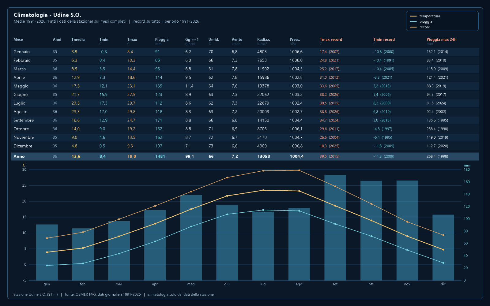
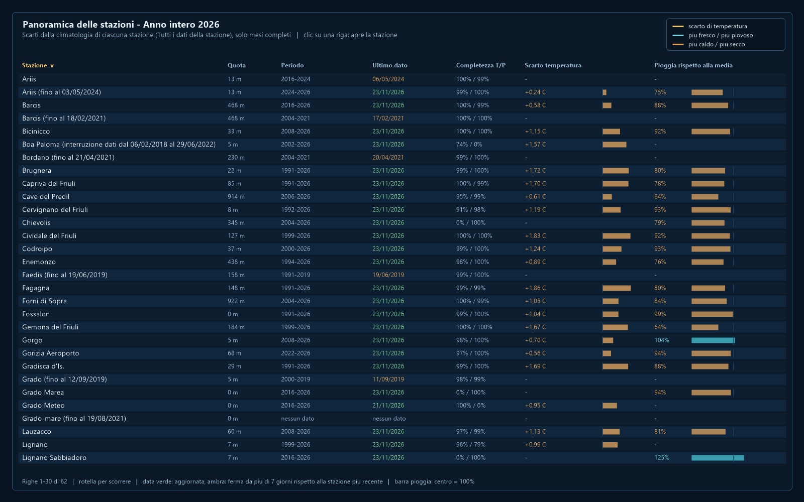
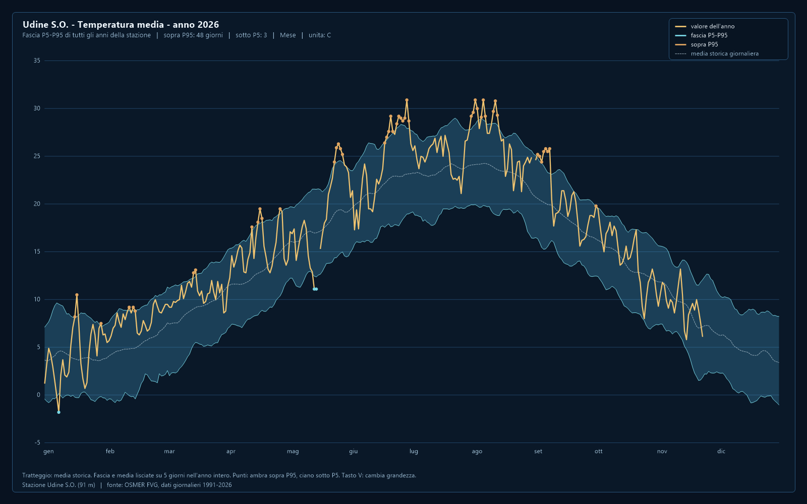
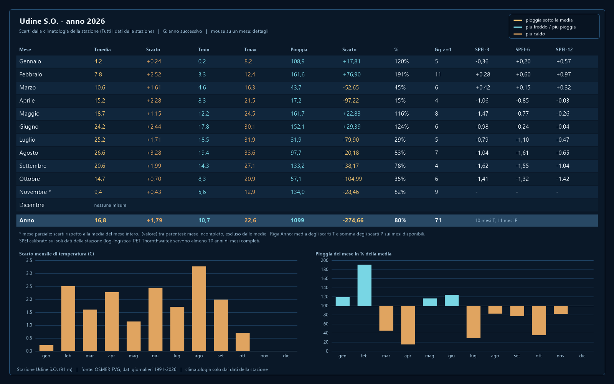
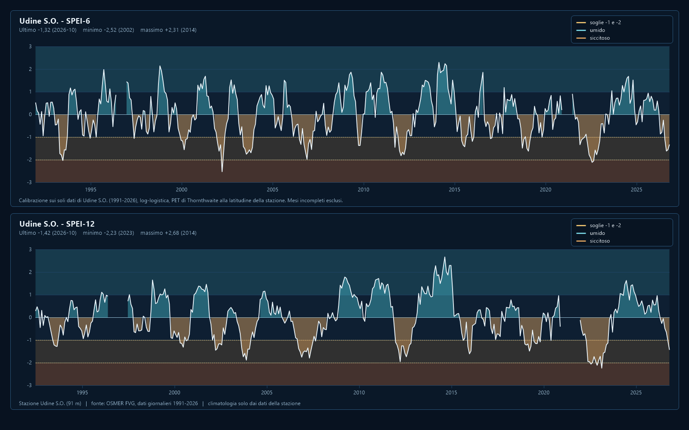
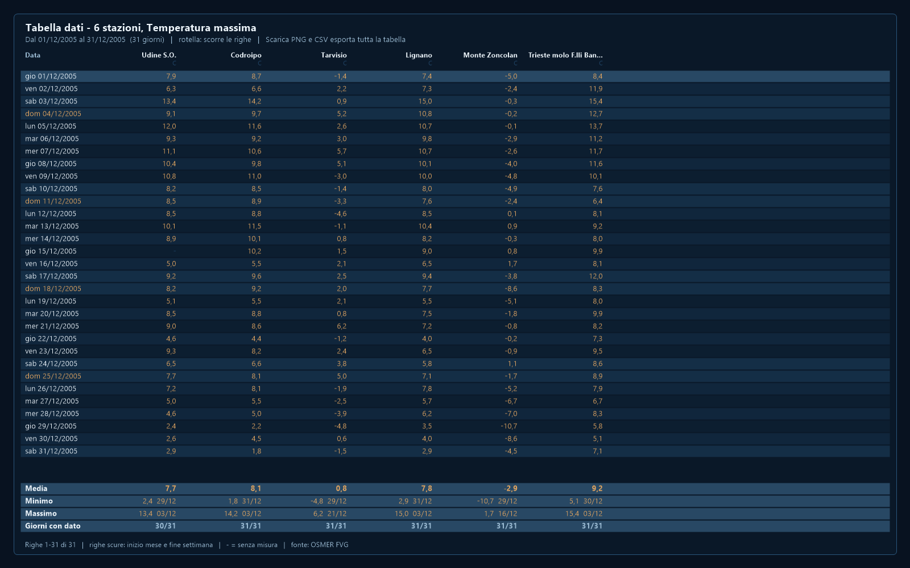
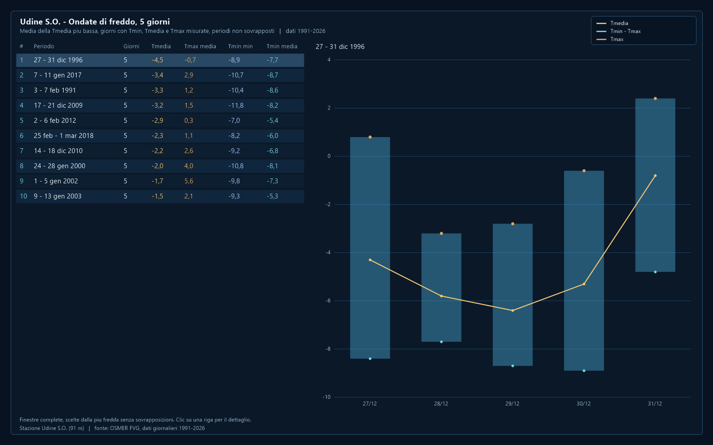

# Console OSMER - clima delle stazioni del Friuli Venezia Giulia

Programma per Windows che legge i dati giornalieri delle stazioni meteo **OSMER FVG**
(ARPA Friuli Venezia Giulia) e ne ricava, **stazione per stazione**, climatologia,
scarti, record, indici di caldo e di pioggia, SPEI. Un solo pulsante aggiorna
tutte le stazioni dal sito OSMER.



## Cosa fa

- **Panoramica stazioni**: tutte le stazioni a confronto per l'anno (o la stagione, o il mese)
  scelto: ultimo dato, completezza, scarto di temperatura e pioggia in % rispetto alla
  climatologia di *ciascuna* stazione.
- **Climatologia**: medie mensili di temperatura media, minima e massima, pioggia, giorni
  piovosi, umidita', vento, radiazione, pressione; record giornalieri con la data; climogramma.
- **Dettaglio anno**: i dodici mesi con scarti, pioggia in %, SPEI-3/6/12.
- **Anno e fascia P5-P95**: valori giornalieri di un anno sopra i percentili storici, per
  qualsiasi grandezza misurata; anno di confronto sovrapposto.
- **Pioggia cumulata** con minimo, massimo e media degli anni completi.
- **Temperatura, Precipitazioni, Bilancio P-PET**: scarto annuale (o stagionale o mensile).
- **SPEI-6 e SPEI-12**, **Classifiche**, **Ondate di caldo e di freddo** (5 e 10 giorni piu'
  caldi o piu' freddi, serie con Tmax oltre soglia o Tmin sotto soglia), **Tmin e Tmax** (notti tropicali,
  gelo, ghiaccio, giorni estivi e caldi, escursione), **Indici di pioggia** (giorni piovosi,
  piogge forti, massimo giornaliero, intensita', periodo secco piu' lungo).
- **Tabella dati**: i valori giorno per giorno di un periodo qualsiasi (per esempio dal
  01/12/2005 al 31/12/2005), per una stazione con tutte le grandezze o per piu' stazioni
  (fino a 10) affiancate su una grandezza, con media, minimo, massimo e totale della pioggia;
  esportabile in CSV.
- Zoom con la rotella, trascinamento, tooltip, esportazione in PNG, PNG 2x, EMF vettoriale
  e CSV; Ctrl+C copia il grafico.

La climatologia usa **solo i dati della stazione** (riferimento a scelta: tutto il periodo
della stazione, il periodo a schermo, oppure 1991-2020 limitato agli anni disponibili).
Un mese entra nelle medie solo se e' completo (temperatura: al massimo 5 giorni mancanti;
pioggia: al massimo 2). Dettagli in [console/LEGGIMI.md](console/LEGGIMI.md).

| | |
|---|---|
|  |  |
|  |  |
|  |  |

## Requisiti

- Windows 10 o 11.
- **Python 3.10 o successivo** (solo per scaricare i dati), con i pacchetti di `requirements.txt`:

  ```powershell
  py -3 -m pip install -r requirements.txt
  ```

- Per compilare dai sorgenti: Visual Studio 2022 (anche Community o Build Tools) con
  "Sviluppo di applicazioni desktop con C++". Non serve se si usa lo zip della pagina Releases.

## Installazione

1. Scaricare lo zip dalla pagina **Releases** ed estrarlo in una cartella qualsiasi
   (oppure clonare il repository e lanciare `console\build.bat`).
2. Installare i pacchetti Python (vedi sopra).
3. Avviare `console\osmer_console.exe`. Windows SmartScreen puo' avvisare perche'
   l'eseguibile non e' firmato: "Ulteriori informazioni" > "Esegui comunque".

## Primo avvio: scaricare i dati

La cartella `dati_stazioni` e' vuota: i dati non sono nel repository. Premere
**AGGIORNA TUTTE DA OSMER** e confermare: la console scarica dal sito OSMER lo storico
completo di tutte le stazioni (circa 60). Ci vuole **piu' di un'ora**, perche' lo script
fa una pausa tra una richiesta e l'altra per non sovraccaricare il sito. Le stazioni
compaiono man mano che sono pronte; la console resta utilizzabile.

In seguito lo stesso pulsante aggiorna gli ultimi 10 giorni di tutte le stazioni in pochi
minuti ("No" nella domanda). "Si" scarica in piu' lo storico delle stazioni che non hanno
ancora un file.

Da riga di comando (stesso risultato):

```powershell
py -3 aggiorna_osmer_unificato.py --action incremental --station all
```

## Struttura

```
console/              sorgenti C++ della console, build.bat, icona, LEGGIMI.md
aggiorna_osmer_unificato.py   aggiornamento di tutte le stazioni (usato dal pulsante)
_codici_supporto/     download dal sito OSMER: uno script per stazione + moduli comuni
dati_stazioni/        CSV scaricati (creati al primo avvio, non versionati)
grafici_console/      esportazioni PNG/EMF/CSV (create dalla console, non versionate)
docs/                 note sull'aggiornamento dei dati e immagini
```

## Tasti principali

`0`-`9` viste, `T` Tmin e Tmax, `P` indici di pioggia, `H` ondate di caldo e freddo, `D` tabella dati,
`PagSu`/`PagGiu` stazione precedente/successiva, `M` stagione, `C` climatologia di
riferimento, `V` grandezza della fascia P5-P95, `G` anno successivo, `S` esporta,
`U` aggiorna da OSMER, rotella zoom, tasto destro annulla lo zoom, `Esc` chiude.

## Dati e licenze

- **Dati**: © OSMER FVG - ARPA Friuli Venezia Giulia (https://www.osmer.fvg.it).
  Questo repository non contiene dati: ognuno li scarica dal sito ufficiale.
  Prima di ripubblicare i dati o i grafici verificare le condizioni d'uso di ARPA FVG
  e citare la fonte. Usare il download con moderazione.
- **Codice**: licenza MIT, vedi [LICENSE](LICENSE). Progetto indipendente, non affiliato
  a OSMER o ARPA FVG.

Per chi usa un assistente AI per modificare o far funzionare il progetto: vedi
[AGENTS.md](AGENTS.md).
